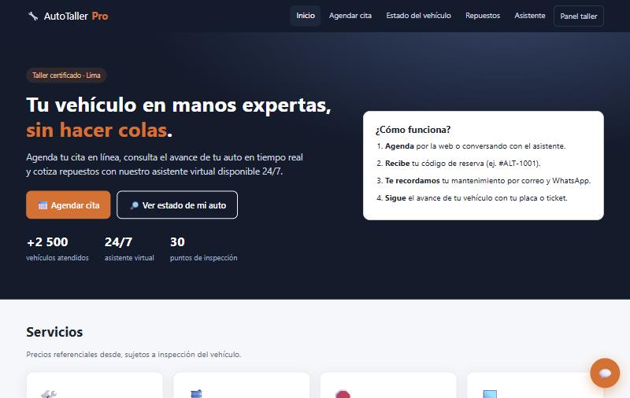
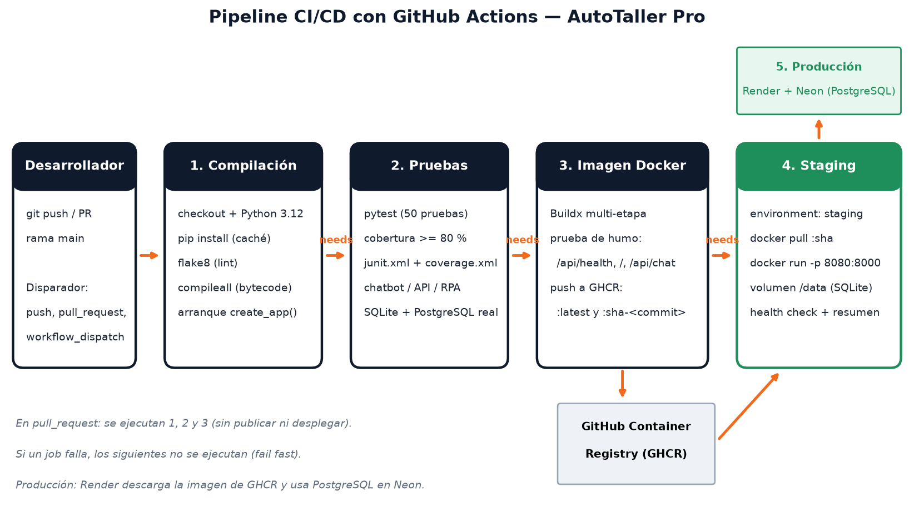
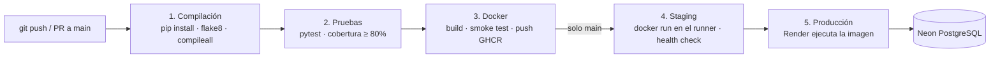

# Taller Huamán Hnos. · Taller automotriz

[](https://github.com/alfredohuchupe/tallerautomotriz/actions/workflows/ci-cd.yml)

**Web en línea:** https://taller-huaman.onrender.com (Render + base de datos PostgreSQL en Neon)


Aplicación web de un taller automotriz que une, en un solo sistema, los dos trabajos previos del curso:

| Origen | Qué era | Qué es ahora en la web |
|---|---|---|
| `chatAutomotriz.py` (Streamlit + Groq) | Chatbot con *Function Calling* para citas, estado y repuestos | **Asistente virtual** (página y widget flotante) con las mismas 3 funciones, ahora conectadas a una base de datos real |
| `Flujo-RPA` (Power Automate Desktop) | Lee Excel, valida correo/teléfono, envía Outlook + WhatsApp y marca "Enviado" | **Módulo de recordatorios** que ejecuta el mismo flujo desde la web |

Todo se compila, se prueba y se despliega en un contenedor **Docker** de forma automática con **GitHub Actions**.



## Funcionalidades

- **Inicio**: servicios con precios referenciales, horario y contacto.
- **Agendar cita**: formulario con validación (teléfono de 9 dígitos, correo) que devuelve un código `#ALT-XXXX`.
- **Estado del vehículo**: búsqueda por placa (`ABC-123`) o ticket (`ALT-1001`) con barra de avance.
- **Repuestos**: catálogo con stock y cotización.
- **Asistente virtual**:
  - Con `GROQ_API_KEY`: IA `openai/gpt-oss-20b` con *Function Calling* (igual que el chatbot original).
  - Sin clave: motor local por reglas que ejecuta las mismas funciones. También es el que usan las pruebas del pipeline.
  - Entrada por voz con la Web Speech API del navegador.
- **Panel del taller**: lista de citas (web, API y chatbot) y actualización del estado y el avance.
- **Recordatorios (RPA)**: valida con las mismas expresiones regulares del flujo RPA y genera el correo y el enlace `wa.me/51…`.
- **API REST**: `/api/health`, `/api/servicios`, `/api/citas`, `/api/estado/<placa>`, `/api/repuestos/cotizar`, `/api/chat`, `/api/recordatorios/ejecutar`.

## Ejecutar en local

```bash
python -m venv .venv
.venv\Scripts\activate            # Windows  (Linux/Mac: source .venv/bin/activate)
pip install -r requirements-dev.txt
python wsgi.py                    # http://localhost:8000
pytest --cov=app                  # pruebas
```

### Con Docker

```bash
docker compose up -d --build      # http://localhost:8080
```

o usando la imagen que publica el pipeline:

```bash
docker run -d -p 8080:8000 -v taller_data:/data ghcr.io/alfredohuchupe/tallerautomotriz:latest
```

Para activar la IA, copia `.env.example` como `.env` y coloca tu `GROQ_API_KEY`. **Nunca subas la clave al repositorio.**

## Pipeline CI/CD





Archivo: [`.github/workflows/ci-cd.yml`](.github/workflows/ci-cd.yml)

| Job | Qué hace | Falla si… |
|---|---|---|
| 1. Compilación | Instala dependencias, ejecuta `flake8`, compila con `compileall` y verifica que la app arranca | hay errores de sintaxis o estilo |
| 2. Pruebas | Ejecuta `pytest` (50 pruebas) con SQLite y con PostgreSQL con cobertura y publica `junit.xml` y `coverage.xml` | falla alguna prueba o la cobertura baja del 80 % |
| 3. Imagen Docker | Construye la imagen multi-etapa, la arranca, prueba `/api/health`, `/` y `/api/chat` y la publica en GHCR | el contenedor no responde |
| 4. Despliegue | Descarga la imagen exacta del commit, reemplaza el contenedor, monta el volumen y hace el health check | el contenedor no queda saludable |

| 5. Producción (Render + Neon) | Pide a Render que ejecute la imagen de ese commit y espera a que la URL pública responda con la nueva versión | Render no responde con la versión nueva en 10 minutos |

Además, el job de pruebas ejecuta la suite dos veces: una con SQLite y otra contra un **PostgreSQL real** (contenedor de servicio), la misma base que se usa en producción.

## Arquitectura en producción

```
Navegador ──► Render (contenedor Docker: web + API + chatbot) ──► Neon (PostgreSQL)
                    ▲
GitHub Actions ─────┘  publica la imagen en GHCR y avisa a Render en cada push a main
```

| Pieza | Dónde | Qué guarda |
|---|---|---|
| Imagen Docker | GitHub Packages (GHCR) | El paquete de la app, una versión por commit |
| Contenedor en ejecución | Render | Nada permanente; se reemplaza en cada despliegue |
| Base de datos | Neon (PostgreSQL) | Citas, clientes y repuestos; no se pierden al desplegar |

La app elige la base automáticamente: con `DATABASE_URL` usa PostgreSQL, y sin ella usa SQLite (archivo local o volumen `/data` en Docker).

## Puesta en línea con Neon + Render (una sola vez)

1. **Neon** (base de datos): crea una cuenta en neon.tech y un proyecto (región cercana, por ejemplo São Paulo o us-east). Copia la *connection string* `postgresql://...?sslmode=require`. Las tablas se crean solas al arrancar la app.
2. **Render** (web): crea una cuenta en render.com. Ve a **New → Web Service → Existing Image**, con la imagen `ghcr.io/alfredohuchupe/tallerautomotriz:latest` (es pública, no necesita credenciales). Elige el plan *Free*.
3. En Render, en **Environment**, agrega:
   - `DATABASE_URL`: la cadena de Neon
   - `SECRET_KEY`: un texto largo al azar
   - `GROQ_API_KEY` (opcional): tu clave de Groq
4. En Render, en **Settings → Deploy Hook**, copia la URL del hook.
5. En GitHub, en **Settings → Secrets and variables → Actions**, agrega:
   - Secret `RENDER_DEPLOY_HOOK`: la URL del hook
   - Variable `RENDER_URL`: la URL pública, por ejemplo `https://tallerautomotriz.onrender.com`
6. Haz un push (o ejecuta el workflow con *Run workflow*). El job 5 despliega y verifica la URL pública.

Las claves (Neon, Groq, hook) van solo en Render o en los secretos de GitHub, nunca en el código.

### Secretos y variables de GitHub (Settings → Secrets and variables → Actions)

| Nombre | Tipo | Uso |
|---|---|---|
| `RENDER_DEPLOY_HOOK` | Secret | Permite al pipeline desplegar en Render |
| `RENDER_URL` | Variable | URL pública para verificar el despliegue |
| `GROQ_API_KEY` | Secret (opcional) | IA en el contenedor de staging |
| `SECRET_KEY` | Secret (opcional) | Clave de sesión en staging |
| `DEPLOY_RUNNER` | Variable (opcional) | `self-hosted` para el job 4 en un servidor propio |

## Estructura

```
app/
  __init__.py        # create_app (fábrica Flask)
  db.py              # SQLite o PostgreSQL (DATABASE_URL) + datos de demostración
  services.py        # agendar_cita, consultar_estado_vehiculo, cotizar_repuesto
  chatbot.py         # Function Calling (Groq) + motor local
  recordatorios.py   # flujo RPA en versión web
  routes.py / api.py # páginas HTML y API REST
  templates/ static/
tests/               # pytest
Dockerfile · docker-compose.yml · .github/workflows/ci-cd.yml
docs/                # documento del trabajo e imágenes
```
